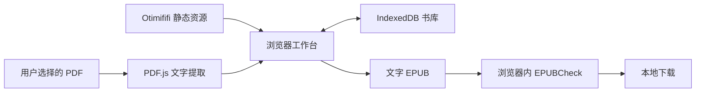

# 网页工作台实现记录

## 运行架构

Otimififi Site 提供应用页面和原创示例资源。PDF.js 在浏览器中提取文字、字形和坐标，React 提供结构校对，IndexedDB 保存书库。fflate 和 XML DOM 构建真实文字 EPUB。EPUBCheck 在当前页面内运行。整个制作流程不请求本机服务，也不上传书籍。



`web/src/browser` 是浏览器运行时。CLI 和 skill 保留 Python 实现。两者使用同一来源模型、排版 CSS 和字体。对照测试比较正文、字形、标题连接和 CSS。原 PDF 保持不变；本地书籍、密码和证据不会进入站点资源或 Git。

排版预览从生成的 EPUB 中读取 XHTML 和 CSS，放入 Shadow DOM 隔离样式。正文仅来自 XML 构建器转义后的文字，不执行书籍脚本。内嵌字体通过 FontFace 的二进制接口加载，不请求远端字体。首段、章节标题和字体与导出共用同一版式。原稿使用 PDF.js canvas 渲染。

EPUB 的正文宽度交给阅读器。模板不设置左右页面留白、百分比正文宽度或正文宽度上限，避免与 iPhone Books 等阅读器的留白叠加。网页预览只在纸面外框保留 16px 左右留白，这部分不写入 EPUB。

## 保存与导出

每次保存都带正整数 revision。IndexedDB 读写事务拒绝过期 revision，防止多个标签页覆盖彼此的修改。任何编辑都会使整体复核与旧导出失效。下载绑定具体 export ID 和 revision；同一版本的草稿与正式版也不能互相替换。

每个 source ID 必须引用一次或带理由排除。原始证据带 SHA-256 摘要；项目恢复时检查模型结构、字形一致性和完整来源覆盖。保存草稿保留逐项复核记录，正式导出要求全部警告已有处理记录。

书库按浏览器 origin 隔离。刷新后继续保存；清除网站数据会移除书库。`navigator.storage.persist()` 由浏览器决定是否授予。项目备份是 ZIP，包含原 PDF、来源证据和制作方案。恢复创建新项目，不覆盖同名书籍，且不恢复旧导出记录。恢复前限制压缩包及解压后大小并校验数据结构。

打开密码只用于 PDF.js 任务，导入后清除输入。密码不写入 IndexedDB 或备份。查看加密原稿时需重新输入密码。

## 实际 EPUBCheck

使用锁定版本 `epubcheck-standalone@5.4.0-build3`。该包由第三方使用 TeaVM 编译 EPUBCheck 5.4.0 及依赖，不是 W3C 官方浏览器发行包。许可证和源码链接随网页提供。

校验器以 `--failonwarnings` 执行。只有 `valid` 且退出码为 0 才允许下载。超时、运行异常或缺少结果都不产生成功结论。报告可下载。依赖验证使用有效 EPUB 和破损 XHTML／缺失资源，与 Java 原版对照通过及失败结果。

## 部署

运行环境提供 `OTIMIFIFI_API_BASE` 和 `OTIMIFIFI_ACCESS_TOKEN`。凭据仅传给发布 API，不进入前端构建或公开文件。

```bash
npm --prefix web ci
.venv/bin/python scripts/deploy_otimififi.py --website xm5pvv
```

脚本先查询站点和首页。前端采用经典 IIFE 脚本，包含样式、PDF.js 和 EPUBCheck。构建产物约 23 MB，以 gzip 和 base64 编码后写入 Site 的 `inlineScripts`。页面通过 DecompressionStream 解压并加载内嵌脚本，避免跨域资源和模板语法冲突。原创示例 PDF 随脚本打包并直接从内存读取；书页 PNG 通过媒体 API 上传。首次加载需要网络；加载完成后可断网制作。

页面使用独立应用布局，关闭分析与评论。发布顺序为更新草稿、提交版本、切换线上版本。部署回执和上传缓存放在忽略的 `.work/`，只记录公开资源信息。发布只调用 Otimififi Site API，不修改平台基础设施。现有 CSP 的适配与公开部署状态见 [站点部署记录](otimififi-platform-requirements.md)。

站点 ID：`xm5pvv`。首页 ID：`eafd635b-2a57-4349-89e2-d9c6059f2033`。站点地址为 `https://xm5pvv.otimififi.site`，首页地址为 `https://xm5pvv.otimififi.site/`。

## 实现过程与验收

2026-11-06，根据 iPhone Books 窄屏阅读反馈，移除共享模板的左右 7% 页面留白、90%/92% 正文宽度和 36em 宽度上限。保留纵向节奏、字体、字号、缩进与正文结构。既有精排成品另生成新文件，12 个 XHTML 和全部字体与原文件字节一致，实际 EPUBCheck 为 0 错误、0 警告。

新增 `npm --prefix web run smoke:reader`，读取完整制作验收导出的 `.work/browser/sample.epub`，检查 320px、390px、768px 和窄屏放大字号。测试在模拟阅读区中加载真实 XHTML、CSS 和字体，验证正文使用全部分配宽度、无横向溢出、无额外左右页面留白。可用 `EPUB_READER_FILE` 指定本机文件，截图只写入忽略的 `.work/reader-layout`。这是浏览器布局检查，不等于 iPhone Books 真机验证。

修订成品的 Chromium 与 WebKit 四组检查均通过。设置 `EPUB_READER_ENGINE=webkit` 可使用 WebKit；本机需先在 `web` 目录执行 `npx playwright install webkit`。默认 CI 使用 Chromium，CLI 与浏览器的对照测试覆盖默认样式和三种可选模板。

2026-11-06，第 7 版修复长章节预览的白底高度不足。预览区的 Flex 拉伸将纸面限制为视口高度，导致后续正文落在灰色背景上。改为顶部对齐，让纸面随正文自然增高。原创示例和 183 页原 PDF 均通过本地桌面、平板、手机的长短章节检查：正文不越出纸面，末段可滚动到可视区，短章节填满预览区，页面无横向溢出。通过 Site 发布后，公开网址的六组预览检查和完整制作流程均通过，包含断网制作、真实 EPUBCheck、刷新恢复、备份恢复和零书籍上传。

回归检查运行 `npm --prefix web run smoke:preview`，已接入 CI。可设置 `EPUB_PREVIEW_PDF` 在本机验证其他 PDF。截图只写入忽略的 `.work/browser-preview`，个人书籍不进入仓库或站点资源。

公开页面实测首次下载约 19 至 36 秒，也遇到过网络下载超时。浏览器验收的导航等待设为 120 秒，交互等待与验收断言保持不变。公开验收分别运行，避免同时下载大型应用资源。

修复提交 `0c26123` 与验收脚本调整 `48d309b` 均已推送。最新 [GitHub CI](https://github.com/qar/pdf-to-epub/actions/runs/42228676052) 全部通过，包含 29 项 Python 测试、13 项前端测试、构建和两组浏览器验收。

2026-11-06，第 6 版通过 Otimififi Site 发布。公开网址完整验收通过；13 项前端测试和 29 项 Python 测试通过，Python 核心覆盖率 85%。另用用户提供的 183 页 PDF 在公开页面加载后断网测试，完成文字提取和通过 EPUBCheck 的草稿导出。个人书籍和输出只存入忽略的本机工作目录。

实现提交 `6ec6de3` 的 [GitHub CI](https://github.com/qar/pdf-to-epub/actions/runs/42223714648) 已通过，包括 Python 包构建、前端检查和独立浏览器流程。183 页草稿另经 Java 原版 EPUBCheck 验证，错误与警告均为 0。

2026-11-06，早期版本使用 Python 本机 API，已完成保存冲突、复核草稿、导出绑定和加密原稿验证。用户随后明确要求打开网址即可使用。`epub-18f` 实现浏览器转换与存储，`epub-09k` 切换界面并验证独立运行，`epub-bjx` 跟踪 Site 发布和公开验收。

验收停用 Python 服务，只启动 Vite 静态预览，并施加与目标站点相同的 CSP。Playwright 在页面加载后断网，完成导入、编辑、撤销、预览、复核、EPUBCheck 和文字 EPUB 下载。再联网刷新，验证书库恢复与备份导入。测试还覆盖密码错误、扫描页警告草稿、多栏来源、首段缩进、原稿 canvas 像素，以及桌面、平板、手机布局。网络审计要求没有后端请求和书籍上传。

```bash
npm --prefix web run build
npm --prefix web run preview -- --port 5178 --strictPort

# 另一个终端中运行；测试生成 PDF 需要 Python 和 qpdf。
npm --prefix web run smoke

# 公开部署后，在真实 origin 验收。
EPUB_APP_URL=https://xm5pvv.otimififi.site npm --prefix web run smoke
```

设置 `EPUB_CHROME_EXECUTABLE` 可使用已安装的 Chrome。设置 `EPUBCHECK_JAR` 会额外执行 Java 原版校验。产物在 `.work/browser`。公开验收必须使用实际响应的 CSP，不能用浏览器禁用安全策略来替代。

## 当前边界

扫描件必须先完成 OCR。无文字层的文件不会转换为页面图片 EPUB。复杂表格、公式、插图、注释链接与逐字替换仍需专项制作。来源覆盖检查不能替代人工检查字词和阅读顺序。

PDF 最大 32 MiB。大型书籍受浏览器内存限制，计算期间界面可能短暂忙碌。校验超时依赖浏览器事件循环，不能保证中断连续执行的同步计算。当前支持页面加载后离线制作，尚未提供离线首次打开或跨设备同步。书库仅属于当前浏览器和网址；跨设备移动需导出并恢复项目备份。
