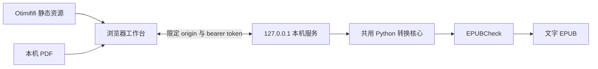

# 网页工作台实现记录

## 运行架构

网页发布在 Otimififi。Python 服务只监听本机 loopback。网页使用同一转换核心提取文字、恢复结构、构建 EPUB 并调用 EPUBCheck。



服务保存原 PDF、不可变的提取证据、制作方案的各个保存版本与导出记录。目录权限为 `0700`。原 PDF 不会被修改。书籍数据不会进入站点资源、分析服务或 Git。

React 负责结构校对。PDF.js 负责原稿渲染。排版预览从核心生成的真实 EPUB 中读取 XHTML 和 CSS，再装入禁止脚本的 iframe。预览与导出使用同一版式。

## 连接与状态

服务启动时生成随机 token。公开网页通过 `/connect` 打开本机确认页。用户确认后，token 通过网址 fragment 返回网页。网页立即清除 fragment，并将 token 保存在当前标签页的 `sessionStorage` 中。服务重启后需重新连接。

请求必须使用允许的 origin、有效 Host 和 bearer token。`/api/session` 仅向同源本机网页提供连接凭据。浏览器的私有网络预检获得明确响应。地址输入只接受 HTTP loopback，避免误把书籍发往远端。

每次保存都带正整数 revision。过期 revision 返回冲突。修改后内容复核和旧导出失效。下载还必须携带 export ID，同一 revision 的草稿和正式版不能互相替换。

打开密码在提取后删除。重新查看加密原稿时，PDF.js 会再次要求密码。预览密码仅留在当前组件内存中。

## API

除健康检查、连接确认和受限的本机会话接口外，API 均要求 `Authorization: Bearer ...`。

| 接口 | 用途 |
| --- | --- |
| `GET /api/health` | 工具可用性 |
| `GET /api/projects` | 本机书库 |
| `POST /api/projects` | 导入 PDF，最大 32 MiB |
| `GET /api/projects/:id` | 制作方案、证据和保存版本 |
| `PUT /api/projects/:id` | 保存方案，检查来源覆盖和 revision |
| `POST /api/projects/:id/preview` | 指定章节的实际 XHTML 预览 |
| `POST /api/projects/:id/review` | 记录整体复核与逐项警告处理 |
| `POST /api/projects/:id/export` | 生成并执行 EPUBCheck |
| `GET /api/projects/:id/download?export=:id` | 下载指定的有效导出 |
| `GET /api/projects/:id/pdf` | 读取原稿 |

本机工作目录可以包含个人全文。备份时应按个人文件处理。页面中的排除操作只调整制作方案，不删除原始提取证据。

## 部署

运行环境提供 `OTIMIFIFI_API_BASE` 和 `OTIMIFIFI_ACCESS_TOKEN`。凭据只传给发布 API，不进入构建参数或公开文件。

```bash
npm --prefix web ci
.venv/bin/python scripts/deploy_otimififi.py --website xm5pvv
```

脚本先查询站点和首页，再构建资源。应用采用经典 IIFE 脚本，样式与 PDF.js worker 随脚本打包，避免静态资源域名缺少 CORS 响应导致模块加载失败。示例 PDF 是仓库生成的原创文字，作为小型 data URL 打包。Otimififi 的媒体 API 不接受 PDF MIME 类型。示例书页 PNG 通过站点媒体路径上传。

页面采用独立应用布局，关闭站点分析与评论。发布按“更新草稿 → 提交版本 → 切换线上版本”执行。公开资源缓存和部署回执位于 `.work/`，只含公开 URL，不含 API token。

2026-11-06 的线上验收确认平台存在限制：非空站点描述触发 HTTP 500；固定 CSP 阻止 `static.otimififi.com` 脚本、本机请求、blob worker 与 iframe。本站描述留空。完整网页运行还需要平台为本站启用明确的应用策略，不能仅靠上传成功判断部署完成。启动失败时页面提供本机工作台入口。

当前站点 ID 为 `xm5pvv`，首页 ID 为 `eafd635b-2a57-4349-89e2-d9c6059f2033`。站点地址和首页地址分别为 `https://xm5pvv.otimififi.site` 与 `https://xm5pvv.otimififi.site/`。

## 实现与验收

2026-11-06 的实现按 `epub-3xl` 及其服务、界面、部署子任务推进。实现顺序为 HTTP 行为测试、本机服务、结构编辑、真实排版预览、浏览器流程和公开部署。审查修复了空 revision 绕过、跨标签页下载错版本和加密原稿预览问题。

单元测试覆盖权限、来源约束、并发保存、编辑后复核失效、导出绑定以及版式设置。端到端脚本使用原创示例，完成导入、编辑、撤销、预览、复核、实际 EPUBCheck 与下载；同时检查原稿 canvas 有非空像素、桌面／平板／手机布局和书籍请求的目标地址。

本机验收结果：29 项 Python 测试、5 项前端测试通过，核心覆盖率为 85%。Ruff、Prettier、TypeScript、生产构建与依赖审计通过。浏览器流程验证了加密原稿密码、部分复核记录保存和文字 EPUB 下载；书籍请求全部发送至 loopback。线上已发布第 5 版，响应为 HTTP 200，但上述 CSP 仍阻止完整应用运行，公开地址验收尚未通过。

```bash
# 先按 README 启动带 EPUBCheck 的本机服务。
cd web
npx playwright install chromium
npm run smoke

# 从公开 origin 验证配对和完整工作流。
EPUB_APP_URL=https://xm5pvv.otimififi.site npm run smoke
```

可用 `EPUB_CHROME_EXECUTABLE` 指定已安装的 Chrome。脚本输出截图和文字 EPUB 到 `.work/browser`。公开地址测试会经过实际连接确认页，不能用注入 token 的方式代替配对验收。

## 当前边界

扫描件必须先完成 OCR。网页目前整理来源和结构，不提供逐字替换原始证据的编辑器。复杂表格、公式、插图与注释链接仍需专项制作。来源覆盖证明没有遗漏或重复引用；它不能替代人工检查 OCR 字词与阅读顺序。

本机服务需持续运行。若浏览器禁止公共站点访问 loopback，可使用本机网页入口。网页资源公开托管不等于云端转换服务。
